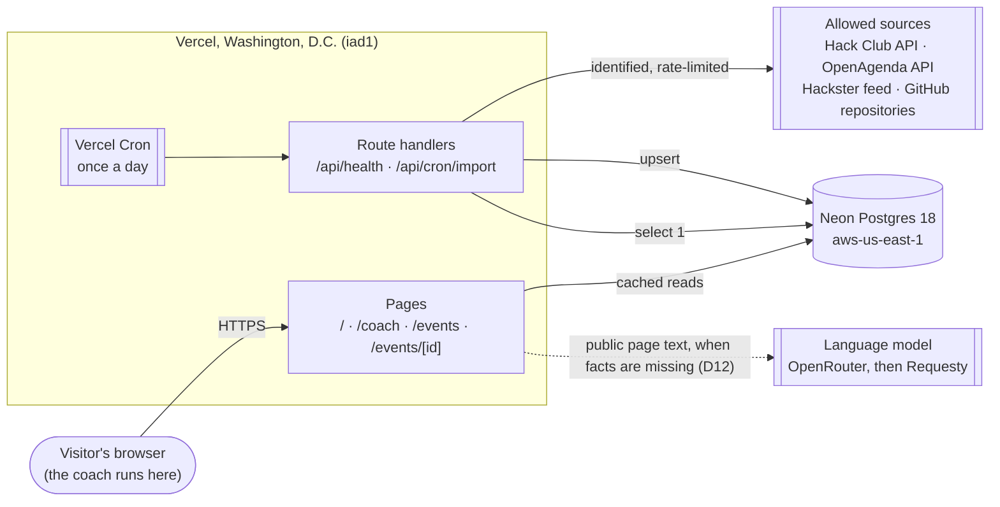
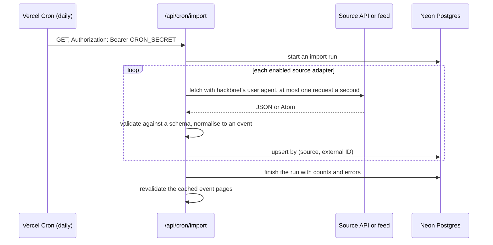

# Architecture

hackbrief is one Next.js 16 application on Vercel, with a Neon Postgres database, a daily import job
for the sources whose terms allow it, and the coach running in the visitor's browser. The
decisions behind each piece are in [decisions.md](decisions.md) (D1 to D12).

## The system



Today the coach, the home page, the health route and the daily import exist; the rest is planned in
[implementation-plan.md](implementation-plan.md).

## Flows

### The coach (built)

The visitor pastes rules at `/coach`. The parsers in `src/lib/coach/` run in the browser and build
the brief; nothing is sent to the server or stored. The page is prerendered as static HTML, so it
costs no function time and never wakes the database. How each number is computed is in
[coach.md](coach.md).

### The daily import (built, issue #10)



- **One adapter per source** in `src/lib/sources/`: its `load` fetches through the function the
  import hands it (once for a feed, page by page for an API with a key), and a pure parser turns
  the response into hackbrief's event shape, tested against recorded fixtures. Adding a source means
  adding an adapter and its row in [sources.md](sources.md), nothing else.
- **Idempotent:** the same run twice changes nothing; an event that disappears from a source is
  marked as no longer listed, not deleted.
- **Within the limits:** Hobby allows cron jobs once a day, started within the hour, and functions
  of up to 300 seconds. If the import grows past that, each source gets its own daily job.
- **Protected:** the route answers only requests carrying the `CRON_SECRET` that Vercel sends, and
  refuses everything when no secret is configured.
- **Briefs after the import** (D13, #60, `src/lib/briefs/`): the same run then builds the upcoming
  listed events' briefs, never-built first, four at a time, and starts none after 220 seconds, so
  the slowest (about 70 s) ends inside the 300-second limit; the rest wait for the next day. An
  unchanged page skips the model; a site that refused waits a week. A visitor who opens an event
  with no stored brief gets one built then and saved after the response; a stored brief a day old
  is shown at once and rebuilt after the response.
- **Measured** on 2 November 2026: 51 events from three sources. Each listing takes about four
  database round trips in turn, so a run took 90 to 120 seconds from a laptop 240 ms from the
  database, and should take seconds on Vercel in the same region. Batching those queries is the
  next step once sources grow.

### Event list (built, issue #11) and event pages (next)

`/events` reads Postgres through a cached function (`use cache` with a lifetime of hours, tagged
`events`, keyed by the day), and the import calls `revalidateTag("events", "max")` when it
finishes. Most visits are then served from the cache without waking the database, which matters on
Neon's Free plan (below). The cached list is the whole upcoming list: filtering, the counts on the
filter chips, grouping by month and pages of 12 are worked out from it in tested code
(`src/lib/events/listing.ts`), so every filter and page shares one cache entry. The filters and the
page come from the query string (`?format=online&page=2`) inside a `<Suspense>` boundary, as Cache
Components requires, and only known values are accepted. The pager is a `nav` of real links that
work without JavaScript; the Left and Right arrow keys turn pages too, except while typing, inside
widgets that use arrows, or with a modifier key held, and focus then moves to the line naming the
page (issue #25).

`/coach?event=<id>` looks one event up through `getEvent`, cached and tagged like the list. The
coach page does not await it: it passes the lookup to the coach as a promise, and only the parts
that name the event (the event panel, the optional page field, the brief's title) read it with
`use()` inside their own Suspense boundaries. The coach is therefore rendered once, in the static
shell, and nothing typed before the lookup lands is lost to a remount (issue #31).

The coach page also passes a second promise, the read of the event's own page (`getEventRules`,
cached for hours; `src/lib/rules/`). The event panel shows "Reading its rules on…" until it lands,
then either builds the brief from the page or says why it could not (issue #41, decision D11). The
fetch uses `undici` with a lookup that refuses non-public addresses at connection time. The
end-to-end tests run with `READ_EVENT_PAGES=off`, so they never reach the internet.

### The fit score (later)

A pure function in `src/lib/fit/` scores an event against a profile (skills, stack, interests, time
zone, online or in person, experience) from 0 to 100, with each part of the score shown and tested
(CLAUDE.md rule 8). Without sign-in (D6) the profile stays in the visitor's browser and the score
is computed there; with sign-in it is saved on the server.

### A language model reads the pages, code keeps the proof

A model reads a listed event's pages and gives each fact of the brief with the sentence it rests on;
code keeps a fact only when that sentence is on the page and code reads the same value there
(D13, `src/lib/coach/fill.ts`). Coaching written by a model from the checked facts comes in #61.
When the model is unavailable, the brief is the coach's own reading.

## Code layout

```text
src/app/                 pages and route handlers
src/lib/coach/           the coach: parsers, strategy, plan, the model's checked facts (D13)
src/lib/model/           the language-model routers: OpenRouter, then Requesty
src/lib/rules/           reading an event's own pages: robots.txt, HTML, PDFs
src/lib/db.ts            the database client
src/lib/health.ts        the health check
src/db/schema.ts         the Drizzle schema
src/lib/sources/         one adapter per source
src/lib/import/          the daily import
src/lib/briefs/          building and storing each listed event's brief (#60)
src/lib/events/          querying and formatting events
src/lib/fit/             the fit score (planned)
```

## Limits that shape the design

| Service | Limit (read 2 November 2026) | Effect on hackbrief |
| --- | --- | --- |
| Vercel Hobby | Non-commercial use only; cron once a day, started within the hour; functions up to 300 s; 1,000,000 invocations and 4 active CPU-hours a month | Daily imports; static and cached pages; move to Pro before taking money in any form |
| Neon Free | 1 GB per project; 100 CU-hours a month; compute pauses after 5 idle minutes; 10 branches per project | Facts only, no copied pages; cached reads so the compute can sleep; clean up preview branches (#7) |
| OpenRouter, paid model | No platform cap on paid models (read 3 November 2026); the key's monthly credit limit | Asked when an event's pages are read; each answer cached a day; the app works without it (D13) |
| Requesty free models | 200 requests a day; concurrent requests scale with the balance | The fallback when OpenRouter fails; the same cache and the same fallback to the parser |

## Security and privacy

- **No accounts and no personal data** in the first version. The coach's text stays in the browser.
- **Secrets** (`DATABASE_URL`, `CRON_SECRET`, `OPENAGENDA_API_KEY`, `OPENROUTER_API_KEY`,
  `REQUESTY_API_KEY`) live in `.env.local` and
  Vercel's environment settings, never in the repository.
- **Public routes reveal nothing internal and cannot keep the database awake:** the health check
  answers "app is up" to everyone and checks the database only for requests carrying
  `CRON_SECRET`, returning a status and a reason, never the driver's error. The event list is
  cached.
- **Collection follows each source's terms** ([sources.md](sources.md)), with attribution shown on
  every event.
- **Dependencies** are audited in `make check` on every pull request.

## When things fail

| Failure | What the visitor sees | How it is caught |
| --- | --- | --- |
| A source is down or blocks hackbrief | Yesterday's events from that source | The import run records the error; blocks stop that source until a person looks |
| A source changes its format | Records that fail validation are skipped, others go through | Counts per source in the import run; adapter tests use recorded responses |
| The database is paused | A slower first page (the compute wakes in well under the 5 s health limit) | `/api/health` |
| The database is down | Cached pages keep working; uncached ones show an error page | `/api/health` returns 503 |
| A cron run is missed | Events a day older | The next run catches up; the run table shows the gap |
| The model is over its limit | The facts without a summary | Summary generation records the refusal |
