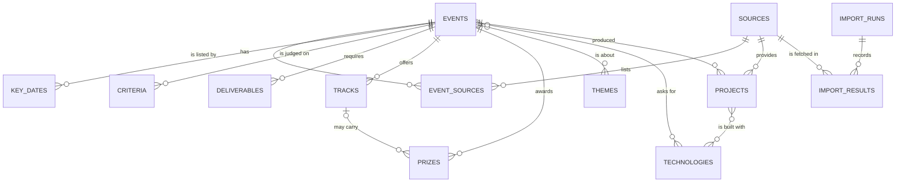

# Data model

The normalised schema for events, their rules and judging criteria, and past projects. It is
built in Drizzle (`src/db/schema.ts`) in the data-model issue (step 4 of
[START-HERE](START-HERE.md)); this page is the design it follows. The coach (built) stores nothing;
these tables hold what the import collects from [allowed sources](sources.md).

## Entities



## Tables

### `sources`

One row per site in [sources.md](sources.md) that hackr collects from.

| Column | Type | Notes |
| --- | --- | --- |
| `id` | serial | |
| `slug` | text, unique | `hackclub`, `kaggle`, `hackster`, `nasa-space-apps` |
| `name`, `url` | text | Shown with every event, linked |
| `channel` | enum: `api`, `feed`, `repository`, `manual` | How hackr reads it |
| `attribution` | text | The credit the source asks for, shown as written |
| `terms_url`, `terms_read_on` | text, date | When the terms were last read |
| `enabled` | boolean | Off stops the import at once, without a deploy |

### `events`

One row per hackathon, however many sources list it.

| Column | Type | Notes |
| --- | --- | --- |
| `id` | uuid | |
| `slug` | text, unique | For URLs: `lagoon-build-weekend-2027` |
| `name`, `organiser` | text | |
| `url` | text | The organiser's own page, preferred over a listing page |
| `format` | enum: `online`, `in_person`, `hybrid` | |
| `city`, `country_code` | text, char(2) | ISO 3166-1 alpha-2 |
| `starts_on`, `ends_on` | date | As written by the organiser |
| `deadline_on` | date | Submission deadline, by date |
| `deadline_time` | text | As written ("11:59 PM PT"); not converted, like the coach |
| `team_min`, `team_max` | smallint, nullable | |
| `solo_allowed` | boolean, nullable | Null when the rules do not say |
| `status` | enum: `upcoming`, `open`, `judging`, `ended`, `unlisted` | Derived in code from the dates, and `unlisted` when no source lists it any more |
| `created_at`, `updated_at` | timestamptz | |

### `event_sources`

Which source listed which event, so one event found in two places stays one event.

| Column | Type | Notes |
| --- | --- | --- |
| `event_id`, `source_id` | foreign keys | |
| `external_id` | text | The source's own ID; unique with `source_id`, which makes imports idempotent |
| `source_url` | text | Linked from the event, as attribution |
| `first_seen_at`, `last_seen_at` | timestamptz | |
| `listed` | boolean | False once the source stops listing it |

### Rules and judging

| Table | Columns | Notes |
| --- | --- | --- |
| `key_dates` | `event_id`, `kind` (registration, start, end, submission, judging, results, other), `label`, `date`, `time_text`, `year_assumed` | The same shape as the coach's `KeyDate` |
| `criteria` | `event_id`, `position`, `name`, `category` (technical, innovation, impact, design, presentation, theme, completeness, other), `weight` (smallint, 0 to 100), `stated` (numeric, nullable), `unit` (percent, points, none) | Weights for one event add up to 100, computed by the coach's `toWholePercents`; checked in code and in tests |
| `deliverables` | `event_id`, `kind` (repository, video, slides, readme, live-demo, description, screenshots, technologies, licence, required-technology, pitch), `label` | The coach's checklist kinds |
| `tracks` | `event_id`, `name`, `description` | |
| `prizes` | `event_id`, `track_id` (nullable), `place`, `amount` (numeric), `currency` (text), `description` | Amounts as numbers, so prize filters work |
| `themes`, `event_themes` | `slug`, `name`; link table | "AI", "climate", "health", "fintech" |
| `technologies`, `event_technologies` | `slug`, `name`; link table | Technologies an event asks for or sponsors |

### Past projects

| Table | Columns | Notes |
| --- | --- | --- |
| `projects` | `event_id`, `source_id`, `name`, `summary`, `team_size`, `url`, `repo_url`, `demo_url`, `video_url`, `licence`, `prize_place`, `won` | Only from sources whose terms allow it (NASA Space Apps, DrivenData winners on GitHub). `summary` is hackr's own words, not a copy |
| `project_technologies` | `project_id`, `technology_id` | Feeds "common stacks among winners" |

### Import bookkeeping

| Table | Columns | Notes |
| --- | --- | --- |
| `import_runs` | `id`, `started_at`, `finished_at`, `status` (running, succeeded, partial, failed) | One per cron run |
| `import_results` | `run_id`, `source_id`, `fetched`, `upserted`, `skipped`, `error` | Per source, so one failing source shows up without hiding the rest |

### Later, with sign-in

`profiles` (skills, stack, interests, time zone, formats, experience) and saved events arrive with
sign-in (D6). Until then a profile lives in the visitor's browser.

## The question this model answers

"AI hackathons that weigh impact over technique", from START-HERE, becomes:

```sql
select e.name, e.deadline_on, impact.weight as impact, technical.weight as technical
from events e
join event_themes et on et.event_id = e.id
join themes t on t.id = et.theme_id and t.slug = 'ai'
join lateral (
  select coalesce(sum(weight), 0) as weight from criteria
  where event_id = e.id and category = 'impact'
) impact on true
join lateral (
  select coalesce(sum(weight), 0) as weight from criteria
  where event_id = e.id and category = 'technical'
) technical on true
where e.status in ('upcoming', 'open') and impact.weight > technical.weight
order by e.deadline_on;
```

## Rules for the schema

- **Facts, not copies.** Store dates, weights, amounts and links; write summaries in hackr's own
  words or leave them out.
- **Numbers in code.** Weights, statuses and fit scores are computed by tested functions and stored
  as their results; the database holds no hidden logic.
- **Every change is a migration** generated by Drizzle Kit and run against the Neon `dev` branch
  before `main`; migrations use `DATABASE_URL_UNPOOLED` (D8).
- **Indexes follow the queries:** `events (status, deadline_on)`, `criteria (event_id, category)`,
  `event_sources (source_id, external_id)` unique.
